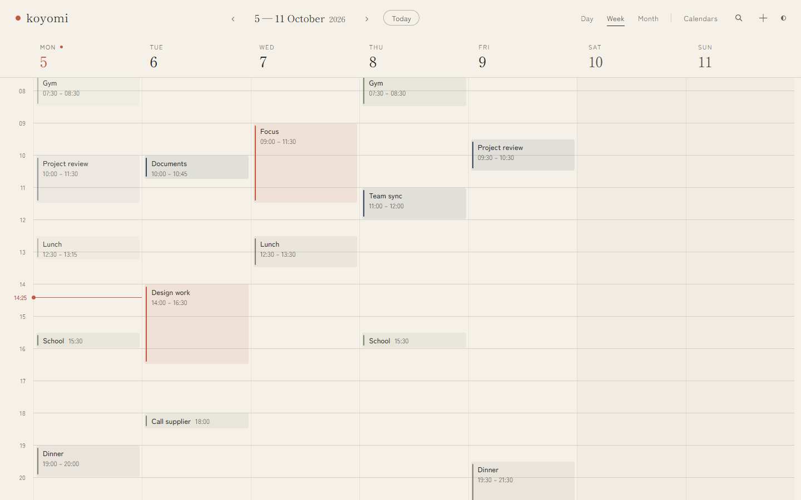
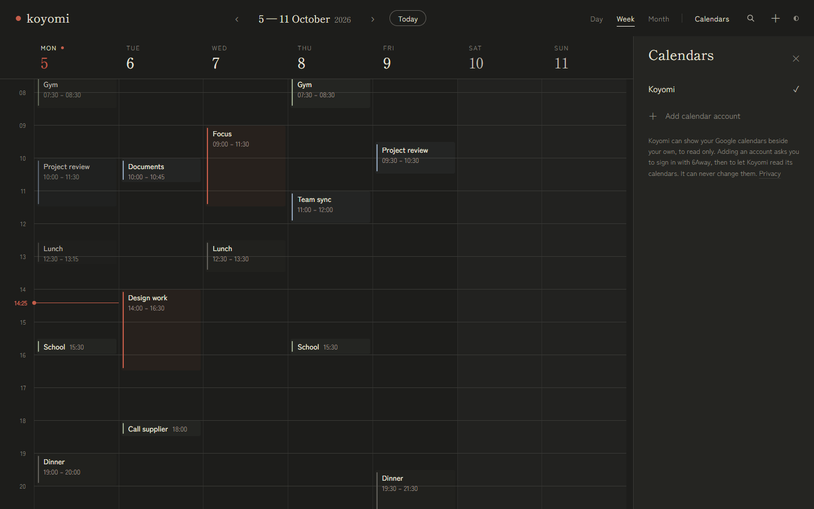
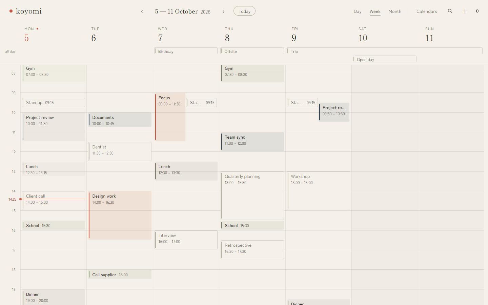

# Koyomi design baseline

The production app as it stands at the first local-first milestone (October 2026) is the approved
Koyomi visual baseline. It was ported from the approved Claude Design prototype and checked against
it side by side.

Do not redesign it. New work should be built in the same visual language, and any change to the look
below needs approval first.

In October 2026 Plan was removed from the product and Calendars took its place: the same drawer,
in the same position, opened by the control that used to say Plan. The calendar itself (the week,
the day, the month, an event and its details) was not redesigned. What changed is listed under
"Calendars, where Plan was".

## Screenshots

Taken from the production build with a neutral sample week, the clock set to Monday
5 October 2026, 14:25. Desktop is 1440×900; phone is 390×844 at twice the pixel density.
`npm run screenshots` retakes them all (with `npm run preview` running), along with the two
pictures the manifest shows when the app is installed.

| View | Light | Dark |
| --- | --- | --- |
| Desktop Week | [desktop-week-light.png](desktop-week-light.png) | [desktop-week-dark.png](desktop-week-dark.png) |
| Desktop Week + Calendars | [desktop-week-calendars-light.png](desktop-week-calendars-light.png) | [desktop-week-calendars-dark.png](desktop-week-calendars-dark.png) |
| Desktop Month | [desktop-month-light.png](desktop-month-light.png) | |
| Phone Day | [mobile-day-light.png](mobile-day-light.png) | [mobile-day-dark.png](mobile-day-dark.png) |
| Phone Calendars | [mobile-calendars-light.png](mobile-calendars-light.png) | |

Month and the phone Calendars sheet are shown in light only: dark changes their palette and nothing else.

## What makes it Koyomi

- **Two palettes.** Light is warm paper; dark is ink at night. Every colour is a token in
  [app/globals.css](../../app/globals.css). The one accent is vermilion, used for the logo dot,
  today and the current time. Event colours are indigo (work), matcha (life), vermilion (focus)
  and a neutral grey (other, the default).
- **Two typefaces.** Shippori Mincho for the wordmark, dates and titles; Zen Kaku Gothic New for
  everything else.
- **Week first on a desktop, one day on a phone.** Below 760px the layout changes rather than
  shrinks: a week strip, a single day, and Calendars as a bottom sheet.
- **A narrow window keeps the same header.** From 980px up it is as in the screenshots. Below
  that it draws in a step at a time rather than changing, so that nothing in it overlaps
  anything else down to 760px. A day's date goes to three letters below 980px ("Wed 27 Sep 2028"), and a
  week's month below 900px ("20 — 26 Sep 2027"), where the date also moves closer to what is
  either side of it. The controls on the right close up below 850px. Below 800px a week and a
  day are shown without their year, as a day is on a phone; a month keeps its year.
- **Calendars is a drawer.** 320px wide; it sits beside the calendar from 1100px and slides over
  it below that. See "Calendars, where Plan was".
- **Events are quiet, but present.** A 2px colour bar and a tint of the same colour: 10% on paper
  and 6% at night, about twice that when selected. Once past, the bar and tint drop to half
  strength and the text goes one step lighter, in both themes. An event is never struck through:
  nothing on the calendar is a task.
- **An event nobody has coloured is still easy to find.** Most events keep the default colour.
  On paper that is a neutral grey as strong as the other three colours, not the pale stone used
  for decoration, so an ordinary week does not dissolve into the background.
- **Quiet structure, readable information.** What a day is read by (event blocks, titles and
  times, hour labels, weekday labels) is set darker than the chrome around it. The background and
  the grid lines stay faint.
- **Text has levels, not opacity.** Every piece of text is set in one of a few named colours and
  is never dimmed by fading it, so its contrast is one that was chosen. All of it meets WCAG AA
  (4.5:1, or 3:1 for large text) in both themes, and `tests/e2e/readability.spec.ts` holds it there.

  | Level | Used for | On paper | At night |
  | --- | --- | --- | --- |
  | `ink` | Titles, dates, what you typed | 13.8:1 | 13.8:1 |
  | `ink2` | Secondary text, weekday labels, past event times | 6.9:1 | 8.5:1 |
  | `muted` | Navigation, hints, counts, the theme switch, days outside the month | 5.1:1 | 5.0:1 |
  | `event-time`, `hour` | Event times and the hour labels | 8.2:1 | 6.4:1 and 5.0:1 |
  | `verm-text` | Small vermilion text: today's date, the current time | 4.9:1 | 5.1:1 |
  | `stone`, `line` | Never text: rules, dots and outlines only | | |

- **Two vermilions, one accent.** The accent (`verm`) is for shapes: the logo dot, the now line,
  an event's bar. On paper it is 3.9:1, too little for an 11px time, so small vermilion text uses
  `verm-text`, a shade deeper. Today's filled disc on a phone uses the deeper shade too: it is
  the one shape with small text on it, and its numeral then reads at 4.9:1 (5.1:1 at night).
  Nothing else changes colour: the accent is never darkened as a whole.
- **The working day is on screen.** The hour height follows the window (44 to 58px) and the timeline
  opens just after 07:30, so about 08:00 to 20:00 is visible without scrolling.
- **Creation is one line.** Click a time, type, Enter: `14:00 │ What are you doing?` A click gives
  the event an hour. To give it another length, drag down (or up) the empty part of the day with a
  mouse or pen: a quiet outline with a vermilion edge follows in quarter-hours, saying the times
  (`10:00 – 11:30`), and letting go opens the same one line over that stretch.

## Calendars, where Plan was

Koyomi is one calm place for all your calendars, and Calendars is where they are chosen and
connected. It took over Plan's place exactly, so nothing about the frame moved:

- **On a desktop, one word in the header.** "Calendars" sits where "Plan" did, after Day, Week
  and Month and before search, in the same type and weight. No count beside it, no icon. It
  opens the drawer; `C` does too, as `P` used to.
- **On a phone, the bar along the foot.** The bar that said Plan says Calendars, in the same
  Mincho, with a quiet line beside it for what is on screen: "Koyomi", or "Koyomi and 3 more".
  It opens the same bottom sheet.
- **The drawer is a list, not a settings page.** "Koyomi", always shown and ticked. Then, under
  a small "GOOGLE" heading, and a "MICROSOFT" one below it in the same style, each connected
  account: its address as a quiet line with "Disconnect" as text beside it, and its calendars
  under it, each a row that is on (a tick) or off (a ring). A heading is there only when an
  account is under it. Then "＋ Add calendar account", drawn like Plan's old "＋ Add" row. Where
  both providers are offered, pressing it opens two quiet rows under it, "Google" and
  "Microsoft", in the row's own type and indented to its text, and nothing more; pressing it
  again closes them. Where only one is offered, it goes straight there. With nothing connected,
  one sentence under it says what adding an account means, naming the providers offered, with a
  link to Privacy.
  Refresh and when things were last read are text at the foot, with "Install Koyomi" when the
  browser offers it. No avatars, no provider logos, no account screen, nothing about how an
  account is connected.
- **Accounts are told apart by their address and nothing else.** No colour for each account, on
  the list or on the calendar.

What went with Plan: the list of things waiting and its count, "Completed", the "＋ Add" field,
dragging a thing onto the week, the "Choose a time for…" pill, "Mark done" and "Back to Plan" in
an event's details, and the struck-through title of a done event.

## Connected calendars

For someone who connects nothing, the calendar is as above. These are the additions for someone
who does. Taken with `npm run screenshots -- --connected` against `npm run preview:connected`,
which stands in for Google with two made-up accounts, and for Microsoft with one; the two
pictures with Microsoft with `npm run screenshots -- --microsoft`.

| View | |
| --- | --- |
| Desktop Week with Google events | [light](desktop-week-google-light.png), [dark](desktop-week-google-dark.png) |
| A Google event open | [desktop-google-event-light.png](desktop-google-event-light.png) |
| Calendars with two accounts | [desktop-calendars-light.png](desktop-calendars-light.png) |
| Phone Calendars with two accounts | [mobile-calendars-google-light.png](mobile-calendars-google-light.png) |
| Phone Day with Google events | [mobile-day-google-light.png](mobile-day-google-light.png) |
| Calendars with Google and Microsoft accounts | [desktop-calendars-microsoft-light.png](desktop-calendars-microsoft-light.png) |
| Add calendar account, choosing where | [desktop-calendars-choice-light.png](desktop-calendars-choice-light.png) |

- **Outline for theirs, tint for yours.** An event from a connected calendar is drawn on plain
  paper with a hairline outline and a grey bar; a Koyomi event keeps its tint and its colour.
  Its title is one text level lighter (`ink2`, regular weight) and its time is `muted`. Quieter,
  never faint: both still meet the same contrast as everything else. No provider logo and no
  provider colours.
- **It can be looked at, not changed.** Opening one shows its title, time, and "Google Calendar ·"
  (or "Microsoft ·") with the calendar's name, then the address of the account that calendar is
  in on a line of its own, in the same quiet type; beside a ring where a Koyomi event has a
  coloured dot. The only action is Open in Google Calendar, or Open in Outlook. It cannot be
  dragged, resized or deleted. Events from either provider look the same on the calendar.
- **The all-day row.** A slim row under the day headings, there only when the days in view have
  something in it. Koyomi's all-day events are tinted, external ones outlined, and one that runs
  for several days is a single bar across them. Two rows show; more fold into "+n", which opens
  the rest. An event of Koyomi's own moves in and out of the row with "All day" and "Set a time"
  in its details.
- **Trouble is one line, and says which trouble.** If the Koyomi sign-in has ended: "Sign in
  again to update Google Calendar". If Google itself has refused an account's permission:
  "Google Calendar needs reconnecting". Either appears as a small pill at the bottom of the
  calendar, and the two are never confused. In Calendars the first is a line with "Sign in", and
  the second is "Needs reconnecting" with "Reconnect", under the one account it is true of; the
  other accounts look as they always do. Being offline, or Google being slow, shows nothing at
  all. The words name the provider of the accounts concerned: "Microsoft calendar needs
  reconnecting", and "Calendars need reconnecting" or "your calendars" where both are. A
  Microsoft account that Microsoft will not let be read at all says so under it in one muted
  line, with nothing to press but Disconnect.

## Differences from the prototype

Each of these was needed for a real calendar and was kept as small as possible:

- A search icon in both headers.
- The event popover edits in place (title, times, day) and has one extra row for colour and repeat.
  Its one action is Delete.
- The timeline covers 00:00 to 24:00 instead of 06:00 to 23:00.
- Overlapping events sit side by side.
- Text fields are 16px on phones, so iOS does not zoom when one is focused.
- The first visit follows the system's light or dark setting; after that the user's choice is kept.
- When the browser can install Koyomi, one line at the foot of Calendars says "Install Koyomi".
  It is absent everywhere else: in Safari and Firefox, at any address but `app.koyomi.guru`, and
  once the app is installed.
- Plan, which the prototype had, is gone, and Calendars is in its place (see above).
- The app starts empty. The sample week exists only in these screenshots.

## The original prototype

The Claude Design export (`Kayomi (1).html`, about 16 MB, almost all of it embedded font data) is
deliberately not in the repository. It is listed in `.gitignore`. These screenshots and the
production code are the reference from here on.
